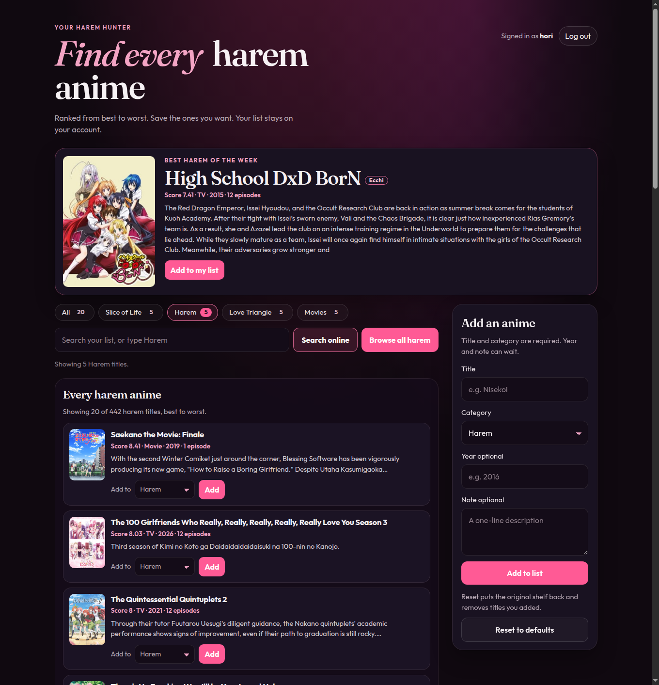

# Your Harem Hunter

Harem Hunter is a private anime shelf built for a friend. Find every harem anime, ranked best to worst. Sign in and the week's top pick sits at the top of the page. Browse the full harem catalog, or type Harem in the search. Each person's saved list stays private.

Live demo: https://anime-list-i39k.onrender.com



## Environment variables

The server reads these from the environment. Names only — do not commit values.

- `DATABASE_URL` — Postgres connection string
- `SESSION_SECRET` — signs the login cookie; at least 16 characters
- `NODE_ENV` — `production` on Render so the session cookie is marked Secure

## How to run

You need Node.js 20 or newer and a Postgres database.

```bash
npm install
```

Create a database, export `DATABASE_URL` and `SESSION_SECRET`, then start the app:

```bash
createdb romance_anime
npm start
```

Open http://localhost:3000. The server creates its tables the first time it starts.

Copy `.env.example` if you want those variables in a file, and export them yourself before `npm start`. The server reads the environment, not a dotenv file. `.env` is gitignored.

On Render, `render.yaml` defines a free web service and a free Postgres database. `DATABASE_URL` comes from the database, and `SESSION_SECRET` is generated. `NODE_ENV` is set to production. The service runs `npm install` then `npm start`, and Render checks `/health`.

## Features

- Sign up and log in with a username and a passphrase of at least 8 characters. The passphrase is stored as a bcrypt hash, never in plain text
- A signed, httpOnly, SameSite session cookie. Auth routes are rate limited
- Each account has a private list in Postgres. A new account starts with the twenty seeded titles
- Filter buttons for All, Slice of Life, Harem, Love Triangle, and Movies, each with a live count. Harem is the shelf you see first
- Best harem of the week: one large card, the same title for everyone that ISO week, rotated through the top 52 by score
- Browse all harem, or search for Harem, to page through every harem title the API tags as harem, best score first and unscored titles last. Each card shows a poster, title, score, type, year, episodes, and a short synopsis. Ecchi titles wear an Ecchi badge. Hentai, erotica, and Rx ratings are left out
- The catalog is cached in Postgres and refreshed about once a day so the app stays under the API rate limit. It asks Jikan v4 (`/anime?genres=35&order_by=score&sort=desc&sfw=true`) and, if that host does not answer, [Tenrai](https://tenrai.org/)
- Search any other title on MyAnimeList the same way, with loading, empty, error, and rate-limit messages
- Add a result to your list. The poster URL is saved with the card
- Add a title by hand, delete a card, or reset to the original twenty
- If this browser still has a guest shelf from before accounts, you can import it after signing in

## What Cursor helped create

Cursor helped me create a beginner-friendly romance anime shelf in plain HTML, CSS, and JavaScript, with real titles sorted into Slice of Life, Harem, Love Triangle, and Movies, plus category counts and cards that stay readable on a phone or a wide window. It also wired up search, adding, deleting, and browser saving, so the list I build is still there after a refresh.

Cursor also added accounts: a small Express server, a private Postgres list for each person, and a login screen so the shelf is no longer shared in one browser. The page is now a harem hunter, with a weekly spotlight and the full harem catalog ranked from best to worst.
